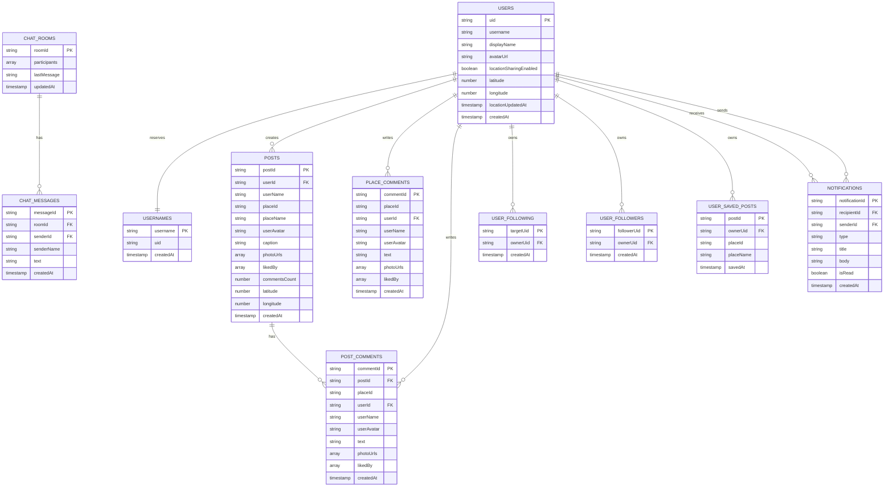

# Firestore ER Diagram (One Page)

This diagram reflects the live schema used by the current app code and security rules.

Notes:

- user_follower/following/saved_posts are subcollections under users/{uid}.
- chat_messages are subcollection documents under chat_rooms/{roomId}/messages/{messageId}.
- usernames is a reservation map for unique handles.
